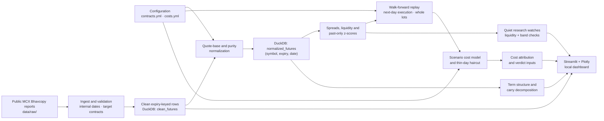

# GoldLens architecture

## Guardrails

- Every analytical table keeps its actual expiry date. The system never constructs a stitched near-month series.
- Signal bands are calculated from observations available on or before the signal date; execution is on the next observed trading day.
- Costs are loaded only from `config/costs.yml`; contract details are loaded only from `config/contracts.yml`.
- The dashboard and published results read real local reports and DuckDB tables, never test fixtures.
